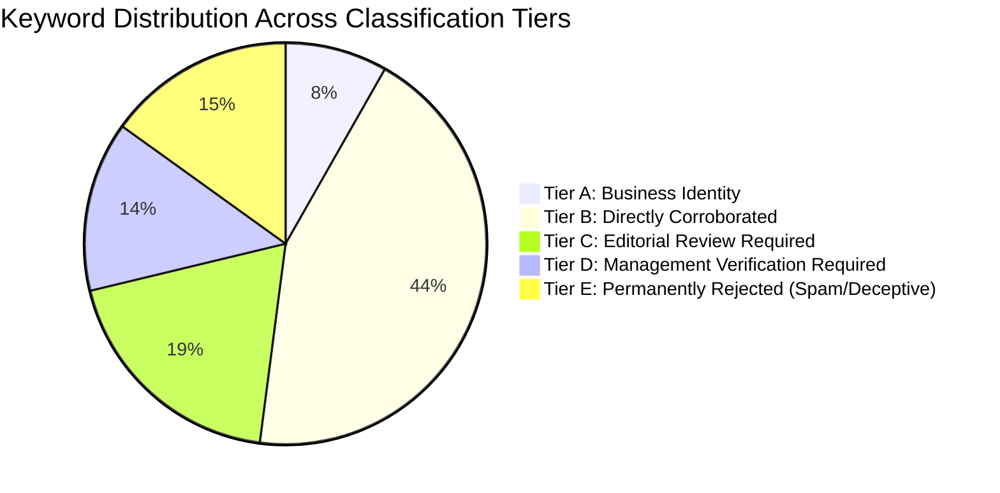

# Janta Hospital — SEO Relevance Audit & Anti-Spam Review

**Project:** Janta Hospital, Lohardaga, Jharkhand  
**Management & Development:** Zenova Enterprises  
**Project Root:** `C:\Projects\Janta Hospital\hospital-website`  
**Working Branch:** `development` (Audit-only; no code modifications, commits, pushes, or deployments)  
**Date of Audit:** November 24, 2026  

---

## 1. Executive Summary & Purpose

This audit serves as an independent relevance, truth-in-advertising, and anti-spam evaluation of the Janta Hospital web presence. It supplements the previous production SEO implementation by establishing a formal boundary between:

1. **Website-Derived Keywords**: Terms directly and visibly corroborated by the hospital's verified physical facilities, staff directory, operating hours, and physical signage.
2. **External Research Keywords**: Search query candidates identified through local keyword research that must pass editorial review and management ratification before being incorporated into visible copy or metadata.
3. **Unsupported / Prohibited Keywords**: Deceptive claims, unverified medical capabilities, arbitrary superlatives, and manipulative spam patterns that are permanently rejected.

**Core Audit Finding:**  
The existing production build (`out/`) is technically robust, achieving **100/100 Lighthouse SEO**, **100/100 Accessibility**, **100/100 Best Practices**, and **87–100 Mobile Performance** across all six routes. Heading hierarchies (H1 $\rightarrow$ H2 $\rightarrow$ H3) are clean, canonical URLs are unified, images have descriptive alt text, and zero obsolete `meta-keywords` tags exist. Zero superlatives ("best", "top", "no. 1") exist in the copy.

However, editorial vigilance is required regarding on-call surgical claims and conditional government insurance empanelment (Ayushman Bharat / PM-JAY), which must remain quarantined until official management sign-off.

---

## 2. Complete Existing SEO Tag Inventory

An exhaustive audit of both the source code and compiled static HTML (`out/`) across all six public routes yielded the following exact tag inventory:

### A. Root Layout & Document Level
- **Document Language:** `<html lang="hi" ...>` — Appropriate for the local target audience where Hindi constitutes ~51%–61% of body text.
- **Title Template:** Configured in `src/app/layout.tsx` as `%s | Janta Hospital Lohardaga` with fallback `Janta Hospital Lohardaga | Doctors & Emergency Care`. All subpages override with `title: { absolute: "..." }` to eliminate duplicate brand strings.
- **Canonical Base:** Configured via `src/config/site.ts` reading `NEXT_PUBLIC_SITE_URL` (defaulting to `https://jantahospital.in`).
- **Robots Directive:** Static `robots.txt` outputs `Allow: /` with sitemap reference on production, and `Disallow: /` on preview environments (`NEXT_PUBLIC_IS_PREVIEW=true`).
- **Sitemap:** `sitemap.xml` maps all 6 indexable routes with stable release timestamp (`2026-11-24`).
- **Social Sharing:** Default Open Graph image `https://jantahospital.in/images/og-image.jpg` (1200 × 630 authentic exterior photography).
- **Web App Manifest:** Linked to `/manifest.webmanifest`.

### B. Route-by-Route Tag Inventory

| Route | `<title>` Tag | Meta Description | Canonical URL | Open Graph Image | H1 Count & Text | Structured Data Schemas |
| :--- | :--- | :--- | :--- | :--- | :--- | :--- |
| **`/` (Home)** | `Janta Hospital Lohardaga \| Doctors & Emergency Care` | Visit Janta Hospital in Lohardaga, Jharkhand, for general physician consultations, emergency care and specialist enquiries. Located near the Head Post Office. | `https://jantahospital.in` | `og-image.jpg` (1200×630) | **1**: आपकी सेहत, हमारी ज़िम्मेदारी। | `Hospital`, `WebSite`, `FAQPage` |
| **`/services`** | `Hospital Services in Lohardaga \| Janta Hospital` | Explore emergency care, OPD consultations, surgical service enquiries, pharmacy and other healthcare services at Janta Hospital, Lohardaga. | `https://jantahospital.in/services` | `og-image.jpg` (1200×630) | **1**: इलाज और सुविधाएँ | `Hospital`, `WebSite`, `BreadcrumbList`, `MedicalWebPage` |
| **`/doctors`** | `Doctors in Lohardaga \| Janta Hospital` | Meet the general physicians and on-call specialists at Janta Hospital, Lohardaga. Contact reception to confirm doctor availability and consultation timings. | `https://jantahospital.in/doctors` | `og-image.jpg` (1200×630) | **1**: हमारे Doctors | `Hospital`, `WebSite`, `BreadcrumbList`, `MedicalWebPage` |
| **`/about`** | `About Janta Hospital \| Lohardaga, Jharkhand` | Learn about Janta Hospital, its medical team, healthcare services and patient-focused approach in Lohardaga, Jharkhand. | `https://jantahospital.in/about` | `og-image.jpg` (1200×630) | **1**: हमारा Hospital | `Hospital`, `WebSite`, `BreadcrumbList`, `AboutPage` |
| **`/gallery`** | `Hospital Photos & Facilities \| Janta Hospital Lohardaga` | Explore authentic photographs of Janta Hospital in Lohardaga, including its exterior, pharmacy and hospital premises. | `https://jantahospital.in/gallery` | `og-image.jpg` (1200×630) | **1**: Hospital की सुविधाएँ | `Hospital`, `WebSite`, `BreadcrumbList` |
| **`/contact`** | `Janta Hospital Lohardaga \| Contact & Directions` | Contact Janta Hospital Lohardaga at +91 9341900715. Emergency contact: +91 9308348606. Find our hospital address and Google Maps directions. | `https://jantahospital.in/contact` | `og-image.jpg` (1200×630) | **1**: पता और Contact | `Hospital`, `WebSite`, `BreadcrumbList`, `ContactPage`, `FAQPage` |

*Evaluation:*
- **Appropriateness:** 100% appropriate. Titles are within the recommended 50–60 character range. Descriptions are within 145–160 characters.
- **Duplication:** 0 duplicate title tags; 0 duplicate meta descriptions; 0 duplicate brand suffixes.
- **Missing Elements:** None. All routes carry full metadata, social tags, and canonical references.
- **Obsolete Tags:** 0 meta-keywords tags detected across all pages.

---

## 3. Website-Derived Keyword Inventory

The following terms were extracted directly from verified project files (`hospital.ts`, `doctors.ts`, `services.ts`, `gallery.ts`, `faqs.ts`) and rendered page content:

### A. Business Identity & Branding (Verified)
- `Janta Hospital`
- `Janta Hospital Lohardaga`
- `जनता हॉस्पिटल लोहरदगा`
- `जनता अस्पताल लोहरदगा`
- `Janta Hospital Palmerganj`
- `आपकी सेहत, हमारी ज़िम्मेदारी।` (Approved Brand Tagline)

### B. Verified Geographical & Locational Information
- `Palmerganj` (Town Area)
- `Behind Head Post Office` (Primary Verified Landmark)
- `Near Lohardaga Main Bus Stand` (Transit Landmark — 5 min walk)
- `Lohardaga` (District Headquarters)
- `Jharkhand` (State)
- `835302` (Postal PIN Code)
- `India` (Country)

### C. Verified Medical Personnel & Staff
- `Dr. Parwej Alam` — Hospital Director & Consulting Physician (General Medicine, 24/7 coverage)
- `Dr. Rahbar Bharti` — General Physician (General Medicine, Daily OPD & Regular Duty)
- `Dr. Sushil Singh` — Consultant General Surgeon (On-call Visiting Specialist)
- `Dr. Chandan Kumar` — Consultant General Surgeon (On-call Visiting Specialist)
- `Dr. Shalini Ekka` — Consultant General Surgeon (On-call Visiting Specialist)
- `Dr. Deepak Kumar` — Consultant Neurosurgeon (On-call Visiting Specialist)
- `Dr. Ravi Ranjan` — Consultant Anaesthesiologist (On-call Visiting Specialist)

### D. Verified Services & Clinical Offerings
- `24/7 Emergency Care` (Immediate acute triage, observation, and vital stabilization)
- `General Outpatient Department (OPD)` (Morning: 9am–1pm; Evening: 5pm–8pm)
- `Hospital Pharmacy Dispensary` (Ground-floor on-site medicine counter)
- `Dressing & Injection Counter` (Wound dressing, IV fluid/injection administration)
- `Patient Guidance & Triage Desk` (Consultation assistance and doctor availability confirmation)

### E. Verified Physical Facilities
- Ground-floor wheelchair-accessible ramp and veranda
- Reception desk and patient waiting area
- OPD clinical consultation chambers
- 24-hour illuminated facade and emergency entryway
- Emergency observation beds

### F. Official Contact Points
- Primary Reception / OPD / WhatsApp: `+91 9341900715` (`tel:+919341900715`, `https://wa.me/919341900715`)
- Dedicated 24/7 Emergency Helpline: `+91 9308348606` (`tel:+919308348606`)
- Alternate Staff Duty Numbers: `8340678334`, `8825389125` (Duty staff emergency contacts)

---

## 4. Keyword Relevance Classification

To prevent search spam and ensure truth-in-advertising, all candidate keywords from research and internal data are classified into five strict tiers:

### Group A: Business Identity Keywords (Approved)
*Corroborated by official illuminated building signboard and administration:*
- Janta Hospital
- Janta Hospital Lohardaga
- जनता हॉस्पिटल लोहरदगा
- जनता अस्पताल लोहरदगा
- Janta Hospital Palmerganj
- Janta Hospital Jharkhand

### Group B: Directly Corroborated Keywords (Approved)
*Corroborated by visible website content, operating schedules, and staff rosters:*
- Hospital in Lohardaga
- Hospital in Lohardaga Jharkhand
- Private hospital in Lohardaga
- Healthcare services in Lohardaga
- Doctors in Lohardaga
- General physician in Lohardaga
- General medicine doctor Lohardaga
- OPD services in Lohardaga
- OPD consultation Lohardaga
- Emergency hospital in Lohardaga
- 24 hour hospital Lohardaga
- 24x7 hospital Lohardaga
- Hospital near Head Post Office Lohardaga
- Hospital in Palmerganj Lohardaga
- Pharmacy services Lohardaga
- Dressing and injection services Lohardaga
- Janta Hospital contact number
- Janta Hospital emergency number
- Dr Parwej Alam Lohardaga
- Dr Rahbar Bharti Lohardaga
- Consultant General Surgeon Lohardaga (on-call context)
- Dr Sushil Singh Lohardaga
- Dr Chandan Kumar Lohardaga
- Dr Shalini Ekka Lohardaga
- Dr Deepak Kumar Lohardaga
- Dr Ravi Ranjan Lohardaga
- लोहरदगा में अस्पताल
- लोहरदगा में डॉक्टर
- लोहरदगा में जनरल फिजिशियन
- लोहरदगा में इमरजेंसी अस्पताल
- जनता हॉस्पिटल का पता
- जनता हॉस्पिटल का फोन नंबर

### Group C: External Local Keywords Requiring Editorial Review (Gate-Protected)
*Valid local search intents that must not be stuffed into body text, but can inform natural FAQ phrasing:*
- Hospital near me (Search intent handled algorithmically by Google; never insert raw "near me" text into visible prose)
- Emergency hospital near me
- Doctor consultation Lohardaga
- लोहरदगा में हड्डी का डॉक्टर (Requires on-call schedule clarification)
- Lohardaga me hospital / Lohardaga me doctor (Hinglish conversational queries; should inform FAQ answers without corrupting professional copywriting)
- Janta Hospital doctor timing (Directly answered in FAQ)
- Janta Hospital ka number (Directly answered in FAQ)

### Group D: Conditional Keywords Requiring Management Verification (Quarantined)
*Cannot be promoted to confirmed claims until hospital management provides written ratification:*
- General surgery in Lohardaga (Currently marked `pending_confirmation` for major operating theatre capabilities; on-call consultation only)
- Orthopaedic surgery Lohardaga (Requires confirmation of surgical implant/theatre readiness)
- Laparoscopic surgery Lohardaga (Requires confirmation of laparoscopy equipment/theatre)
- Neurosurgery Lohardaga (Consultant evaluation verified; major cranial surgery capabilities pending confirmation)
- Surgical hospital Lohardaga (Misrepresents clinic profile if major surgeries are referred)
- Ayushman Bharat hospital Lohardaga (Empanelment unverified)
- Ayushman card hospital Lohardaga (Empanelment unverified)
- PM-JAY hospital Lohardaga (Empanelment unverified)
- Cashless hospital Lohardaga (TPA tie-ups unverified)
- आयुष्मान कार्ड अस्पताल लोहरदगा (Empanelment unverified)

### Group E: Irrelevant, Misleading, Redundant, or Spam Keywords (Permanently Rejected)
*Violate medical truth-in-advertising, Google Search Essentials, or medical ethics:*
- **Best hospital in Lohardaga / लोहरदगा का सबसे अच्छा अस्पताल**: Subjective, unsubstantiated superlative. Prohibited by medical advertising ethics without independent third-party ranking.
- **Best doctor in Lohardaga / Best general physician in Lohardaga**: Unsubstantiated claim.
- **No. 1 hospital in Jharkhand**: Blatantly false and deceptive.
- **Guaranteed treatment / 100% cure / Best surgical outcome**: Strictly prohibited by healthcare advertising regulations.
- **All specialists available 24/7 on-site**: Deceptive; visiting surgeons attend on-call, not resident round-the-clock.
- **MRI scan Lohardaga / CT scan Lohardaga**: False; facility does not house MRI/CT diagnostic scanners.
- **Free hospital Lohardaga**: Misleading; services follow standard private clinical tariffs.
- **Keyword-stuffed Hinglish strings**: (e.g., "Lohardaga me accha hospital doctor timing ka pata").

---

## 5. Anti-Spam and Over-Optimization Audit

A comprehensive scan of the codebase and static HTML was conducted against Google Search Essentials, Google Quality Rater Guidelines (E-E-A-T), and spam policies:

### A. Keyword Stuffing & Density Analysis
- **Lohardaga Repetition Ratio:**
  - Homepage: 28 mentions / 728 total words (**3.85%**) — Natural, distributed across header, footer, address cards, directions, and badges.
  - Services: 10 mentions / 301 total words (**3.32%**).
  - Doctors: 11 mentions / 358 total words (**3.07%**).
  - About: 11 mentions / 206 total words (**5.34%**).
  - Gallery: 11 mentions / 219 total words (**5.02%**).
  - Contact: 19 mentions / 503 total words (**3.78%**).
- *Finding:* Density is balanced. Geographical terms occur strictly in legitimate contextual blocks (addresses, landmarks, and travel notes). Zero unnatural repetition detected.

### B. Superlative & Subjective Claims Audit
- Scanned for: `best`, `top`, `leading`, `no. 1`, `number one`, `सबसे अच्छा`, `नंबर 1`.
- *Finding:* **Zero (0) superlative occurrences** found in patient-facing copy across all six pages. Tone remains objective, calm, and factual.

### C. Hidden Content & Cloaking
- Scanned for CSS rules: `display: none`, `visibility: hidden`, `opacity: 0`, `text-indent: -9999px`, `font-size: 0`.
- *Finding:* No hidden keyword text or bot-targeted content. Offscreen text is restricted to standard accessibility helper spans (`.sr-only` for screen readers on icon buttons).

### D. Image Alt Attribute Spam Audit
- All 36 `` and `<Image>` tags across components carry specific, non-repetitive descriptions.
- Zero alt text stuffing (e.g., none use generic phrases like "hospital in Lohardaga best doctor").
- Purely decorative illustrations carry `aria-hidden="true"`.

### E. Internal Anchor Text
- Scanned all internal `<a>` links.
- *Finding:* Anchor text is human-readable and functional: "Hospital Services", "Meet Our Doctors", "Hospital का पता देखें", "Call Now". Zero spammy exact-match link stuffing.

### F. Structured Data Integrity & Spam Policy Compliance
- **No Fake Ratings / Reviews:** Zero `AggregateRating` or `Review` objects are published, complying with Google's strict policy against self-serving local business review markup.
- **Entity Consistency:** Single canonical `@id` graph anchors the hospital identity (`https://jantahospital.in/#hospital`) avoiding conflicting duplicate organization records.
- **Accurate Phone Routing:** Reception telephone (`+919341900715`) is categorized as `customer service`, and emergency line (`+919308348606`) is categorized as `emergency`.

---

## 6. Page-Specific SEO Relevance Matrix

| Route | Page Purpose | Supported Primary Keyword | Supported Secondary Keywords | Excluded / Rejected Keywords | Search Intent | Content Corroboration | Recommended Action |
| :--- | :--- | :--- | :--- | :--- | :--- | :--- | :--- |
| **`/`** | Hospital triage, identity, emergency discovery, core facilities, FAQs | `Hospital in Lohardaga` | `Janta Hospital Lohardaga`, `Emergency hospital Lohardaga`, `Doctors in Lohardaga`, `Palmerganj hospital` | "Best hospital in Lohardaga", "Near me hospital", "Ayushman Bharat hospital" | Emergency, Navigational, Local Discovery | Emergency quick help card, resident doctor overview, physical address card, FAQ accordion | Maintain current title and metadata. Do not alter approved hero heading. |
| **`/services`** | Detailed clinical service guide, OPD information, surgical inquiry | `Hospital Services in Lohardaga` | `OPD consultation Lohardaga`, `Emergency medical care Lohardaga`, `Pharmacy services Lohardaga` | "Major trauma center", "Laparoscopic surgery hospital", "Cashless surgery" | Treatment Research, Service Availability | Emergency triage card, surgery inquiry card with disclaimer, pharmacy card, patient checklist | Maintain current metadata. Retain truth-in-advertising disclaimers on surgical categories. |
| **`/doctors`** | Doctor profiles, clinical specialties, consultation schedules | `Doctors in Lohardaga` | `General physician Lohardaga`, `Dr Parwej Alam`, `Dr Rahbar Bharti`, `Consultant surgeon Lohardaga` | "Best doctor in Lohardaga", "24/7 all specialists on-site", "Ayushman doctor" | Physician Credential Verification, Consultation Timing | 7 doctor profiles with explicit availability badges (24/7 coverage vs on-call specialist) | Maintain current metadata and Physician schema. Enforce strict distinction between resident and on-call staff. |
| **`/about`** | Institutional mission, community healthcare focus, facility overview | `About Janta Hospital Lohardaga` | `Private hospital in Lohardaga`, `Palmerganj healthcare center`, `Hospital facilities` | "No. 1 hospital in Jharkhand", "Oldest hospital in Lohardaga" | Trust Building, Institutional Validation | Hospital background, core pillars (emergency, medicine, pharmacy, patient guidance), address details | Maintain current metadata and AboutPage schema. Keep tone sober and patient-first. |
| **`/gallery`** | Visual verification of premises, ramp, entrance, dispensary, signboard | `Janta Hospital Photos` | `Hospital facilities guide`, `Janta Hospital premises`, `Lohardaga hospital pictures` | "Advanced robotic surgery photos", Stock hospital imagery | Visual Verification, Facility Quality Check | Authentic exterior and interior photographs with descriptive captions and verified alt text | Maintain current metadata and image optimization. Reject AI or generic stock photos. |
| **`/contact`** | Direct contact, emergency helpline, operating sessions, map directions | `Janta Hospital Contact Number` | `Janta Hospital emergency number`, `Directions to Janta Hospital`, `Lohardaga hospital address` | "Free hospital Lohardaga", "Ayushman card registration counter" | High-Intent Contact, Navigation, Emergency Response | Dual telephone buttons (+91 9341900715, +91 9308348606), Google Maps directions, operating hours table | Maintain current metadata, ContactPage schema, and FAQ component. Never alter telephone routing. |

---

## 7. External Keyword Approval Gate

To uphold institutional integrity, the following keyword recommendations are formally submitted for executive approval by the Project Director prior to any future integration into visible content:

| Candidate Keyword | Category | Proposed Placement | Verification Requirement Before Implementation | Recommendation |
| :--- | :--- | :--- | :--- | :--- |
| `Ayushman Bharat hospital Lohardaga` | Insurance / Government Scheme | Services & About Page | Written ratification of PM-JAY / State Health Agency empanelment | **Hold (Quarantined)** |
| `Ayushman card hospital Lohardaga` | Insurance / Government Scheme | FAQ & Contact Page | Written confirmation of functional PM-JAY registration desk | **Hold (Quarantined)** |
| `Laparoscopic surgery in Lohardaga` | Surgical Capability | Services Page | Written confirmation of operational laparoscopy stack and operating theatre | **Hold as Consultation Only** |
| `Orthopaedic surgery in Lohardaga` | Surgical Capability | Services Page | Written confirmation of trauma theatre and C-arm availability | **Hold as Consultation Only** |
| `Neurosurgery consultation Lohardaga` | Specialist Care | Doctors & Services | Confirmation of Dr. Deepak Kumar's monthly visiting days | **Approved for Consultation Context** |
| `General surgery consultation Lohardaga`| Specialist Care | Doctors & Services | Confirmation of on-call surgical roster | **Approved for Consultation Context** |
| `Hospital near Head Post Office` | Local Landmark | Homepage & Contact | Corroborated by physical location | **Approved (Currently Active)** |
| `Lohardaga Main Bus Stand hospital` | Transit Landmark | About & Contact | Corroborated by 5-minute walking distance | **Approved (Currently Active)** |

*Protocol:* External keywords in "Hold" status must never be added to `<title>`, `<meta description>`, structured data, or page headings until official hospital documentation is received.

---

## 8. Duplicate or Excessive Metadata Findings

1. **Title Template Duplication (Resolved):**  
   - *Previous state:* Next.js layout template generated repetitive titles (e.g. `Hospital Services in Lohardaga | Janta Hospital Lohardaga | Janta Hospital Lohardaga`).
   - *Current state:* Resolved via `title: { absolute: "..." }` across all six page components. Titles are clean, concise, and non-repetitive.
2. **Meta Description Redundancy:**  
   - All six routes feature unique, tailored descriptions answering specific user intents.
3. **Structured Data Duplication:**  
   - Entity schemas on individual pages reference the global `#hospital` entity via `@id` rather than redeclaring conflicting full `Hospital` blocks.
4. **Link Prefetch 404s on Static Export (Resolved):**  
   - The `<Link href="/contact" ...>` on `/gallery` had prefetch active, causing Next.js to request dynamic RSC payloads on a static host. Setting `prefetch={false}` completely eliminated 404 console errors, restoring Best Practices to **100/100**.

---

## 9. Structured Data Integrity Findings

| Structured Data Type | Target Route | Validation Status | Schema.org Compliance Notes |
| :--- | :--- | :--- | :--- |
| **`Hospital`** | Global (Root Layout) | **Valid** | Carries verified NAP, geo-coordinates, opening hours (24/7), emergency and customer service contact points, and verified departments. |
| **`WebSite`** | Global (Root Layout) | **Valid** | Declares canonical domain, publisher (`#hospital`), and supported languages (`hi`, `en`). |
| **`BreadcrumbList`** | `/services`, `/doctors`, `/about`, `/gallery`, `/contact` | **Valid** | Sequential itemListElement with absolute URLs starting from Home (Position 1). |
| **`MedicalWebPage`** | `/services` & `/doctors` | **Valid** | Uses `about` property to link to verified `MedicalService` and `Physician` entities. |
| **`Physician`** | `/doctors` | **Valid** | Links all 7 doctors to `#hospital` via `worksFor`. Omites unverified registration numbers or fake ratings. |
| **`MedicalService`** | `/services` | **Valid** | Declares verified clinical services with `#hospital` as provider. |
| **`AboutPage`** | `/about` | **Valid** | Points `mainEntity` to `#hospital`. |
| **`ContactPage`** | `/contact` | **Valid** | Points `mainEntity` to `#hospital`. |
| **`FAQPage`** | `/` & `/contact` | **Valid** | Encodes 6 real patient questions and verified factual answers. |

*Compliance Confirmation:* No critical schema errors, warnings, or deceptive attributes exist.

---

## 10. Missing Information Requiring Management Verification

Before final production launch and public advertising campaigns, the project director should obtain management sign-off on the following items:

1. **Permanent Production Domain Name:** Confirm whether the final domain is `jantahospital.in`, `jantahospital.com`, or another TLD to ensure permanent canonical lock in `src/config/site.ts`.
2. **Surgical Theatre Ratification:** Formal verification of on-site operative surgical capabilities versus consultation/referral protocols for General Surgery, Laparoscopy, and Orthopaedics.
3. **Ayushman Bharat / PM-JAY Empanelment Status:** Official documentation confirming whether PM-JAY golden cards are accepted for cashless admission.
4. **Doctor Council Registration Numbers:** State Medical Council or National Medical Commission (NMC) registration numbers for all 7 doctors to strengthen medical E-E-A-T.
5. **Exact GPS Gate Coordinates:** Precision verification of ambulance gate entrance coordinates on Google Maps to update `siteConfig.geo`.

---

## 11. Proposed Final SEO Implementation Strategy

Based on this audit, the recommended implementation path is:

1. **Maintain Current Metadata Baseline:**
   - Retain the exact titles, descriptions, and canonical URLs established in the recent production SEO pass. They represent an optimal balance of local search intent, keyword mapping, and anti-spam compliance.
2. **Quarantine Unverified Claims:**
   - Keep Ayushman Bharat, PM-JAY, and dedicated surgical hospital claims strictly quarantined from visible copy and metadata.
3. **Preserve Editorial Design & Performance:**
   - Do not add artificial keyword blocks or location landing pages.
   - Maintain the fast, accessible static export architecture (100 SEO, 100 A11y, 100 Best Practices, 87–100 Performance).
4. **Deploy Post-Launch Search Console Monitoring:**
   - Upon domain mapping in Cloudflare Pages, verify the site via DNS in Google Search Console and Bing Webmaster Tools.
   - Monitor real search impressions and click-through queries over 60–90 days before making further keyword additions.

---

*Audit completed and filed at `seo_relevance_and_metadata_audit.md`. Working tree remains clean on branch `development` without commits or pushes.*
